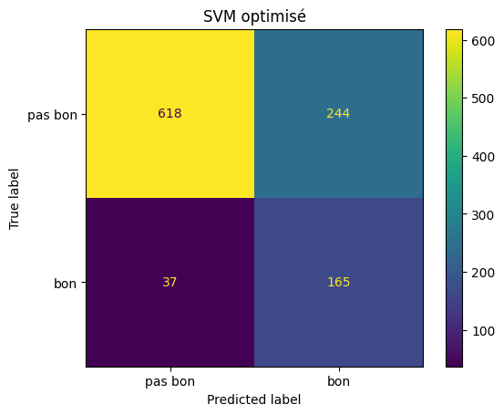
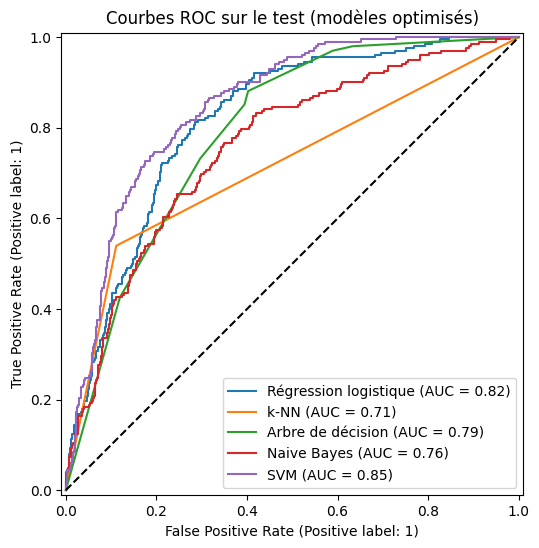

# 🍷 Classification de la qualité du vin

Projet de **Machine Learning I** (EFREI Paris, 2026–2027).
L'objectif est de prédire si un vin est **bon** (note d'experts ≥ 7) uniquement à partir de ses **mesures physico-chimiques** : acidité, sucre, alcool, pH, sulfites…

> **Résultat principal :** un SVM à noyau RBF obtient **F1 = 0,54**, **AUC = 0,85** et **82 % de rappel** sur un jeu de test jamais utilisé avant l'évaluation finale.

---

## Sommaire

- [Données](#données)
- [Démarche](#démarche)
- [Résultats](#résultats)
- [Structure du dépôt](#structure-du-dépôt)
- [Installation et exécution](#installation-et-exécution)
- [Rapport](#rapport)
- [Auteurs](#auteurs)

---

## Données

Jeu de données [**Wine Quality**](https://archive.ics.uci.edu/dataset/186/wine+quality) de l'UCI Machine Learning Repository (Cortez *et al.*, 2009). Il réunit 1 599 vins rouges et 4 898 vins blancs portugais (*Vinho Verde*), décrits par 11 variables physico-chimiques et une note de 0 à 10.

| Étape | Effectif |
|---|---|
| Vins au départ (rouges + blancs) | 6 497 |
| Doublons supprimés | 1 177 |
| **Vins utilisés** | **5 320** |
| dont « bons » (note ≥ 7) | 19 % |

Le fort **déséquilibre des classes** (19 % de bons vins) guide toute la démarche : un modèle qui répondrait toujours « pas bon » aurait 81 % d'accuracy sans détecter aucun bon vin.

---

## Démarche

Le notebook [`projet_vin.ipynb`](projet_vin.ipynb) suit les étapes vues en cours :

| # | Étape | Choix principaux |
|---|---|---|
| 1 | Chargement | Fusion rouges + blancs, variable `type` |
| 2 | Prétraitement | Aucune valeur manquante · 1 177 doublons supprimés **avant** le découpage · valeurs aberrantes détectées par la règle de Tukey (1,5 × IQR, par couleur) et **conservées** · encodage de `type` en 0/1 |
| 3 | Cible | `bon = quality ≥ 7` · traitement du déséquilibre : découpage stratifié, `class_weight="balanced"`, métriques F1 et AUC |
| 4 | Exploration | Histogrammes, matrice de corrélation, boxplots : l'**alcool** est la variable la plus liée à la qualité (r = +0,42) |
| 5 | Préparation | Train / test 80 / 20 stratifié · standardisation (z-score) ajustée sur le train uniquement |
| 6 | Sélection de variables | **RFE** (méthode *wrapper*) : alcool 1er, acidité volatile 2e · les 12 variables sont conservées |
| 7 | Modélisation | Régression logistique, k-NN, arbre de décision (entropie), Naive Bayes gaussien, SVM (noyau RBF) |
| 8 | Évaluation | Validation croisée 5 plis sur le train (prédictions *out-of-fold*) · matrices de confusion, courbes ROC · diagnostic **biais / variance** (F1 train vs F1 validation) |
| 9 | Optimisation | **Grid Search** (régression logistique, arbre), **Random Search** (SVM), les deux pour le k-NN · critère : F1 en validation croisée · **le jeu de test n'est utilisé qu'une seule fois**, pour l'évaluation finale |
| 10 | Conclusion | Lecture de la matrice de confusion du SVM, tableau récapitulatif, limites et pistes d'amélioration |

---

## Résultats

### Diagnostic biais / variance (modèles par défaut, validation croisée)

| Modèle | F1 train | F1 validation | Diagnostic |
|---|---:|---:|---|
| Régression logistique | 0,537 | 0,539 | biais (frontière linéaire) |
| k-NN (k = 5) | 0,645 | 0,464 | variance |
| Arbre de décision | 1,000 | 0,405 | **forte variance** |
| Naive Bayes | 0,496 | 0,493 | biais (hypothèses non respectées) |
| SVM (RBF) | 0,577 | 0,545 | **meilleur compromis** |

L'arbre non contraint apprend le train par cœur (F1 train = 1) : la Grid Search limite sa profondeur à 3, ce qui fait passer son F1 de validation de 0,40 à 0,51.

### Évaluation finale sur le jeu de test (1 064 vins, dont 202 bons)

| Modèle (optimisé) | F1 CV | **F1 test** | AUC | Rappel | Précision |
|---|---:|---:|---:|---:|---:|
| **SVM (RBF)** — C = 100, γ = 0,01 | **0,544** | **0,540** | **0,850** | 0,817 | 0,403 |
| Régression logistique — C = 0,01 | 0,540 | 0,533 | 0,817 | 0,797 | 0,400 |
| Arbre de décision — profondeur 3 | 0,511 | 0,488 | 0,791 | 0,733 | 0,366 |
| Naive Bayes | 0,493 | 0,482 | 0,759 | 0,653 | 0,382 |
| k-NN — k = 1, Manhattan | 0,482 | 0,536 | 0,714 | 0,540 | 0,532 |

Le modèle final est choisi **sur le F1 en validation croisée**, puis confirmé sur le test. Le SVM retrouve **165 des 202 bons vins** du test.

<p align="center">
  
  
</p>

**Lecture :** le SVM retrouve environ 82 % des bons vins et n'en manque que 37, mais produit 244 fausses alertes (précision de 0,40). Il convient donc à un **pré-filtrage** des vins à faire goûter, pas à une décision automatique.

### Limites et perspectives

- Beaucoup de fausses alertes : le modèle sert à présélectionner, la décision finale reste à la dégustation.
- Les résultats dépendent du seuil « note ≥ 7 » et du déséquilibre qu'il crée ; les mesures de laboratoire ne capturent pas tout le goût.
- La RFE repose sur un modèle linéaire.
- Pistes : Random Forest, Gradient Boosting, rééquilibrage SMOTE, ajustement du seuil de décision, modèles séparés pour les rouges et les blancs ; côté ingénierie, tests unitaires, Docker, petite application web.

---

## Structure du dépôt

```
projet_vin_ml/
├── projet_vin.ipynb          # notebook complet (code, graphiques, commentaires)
├── data/
│   ├── winequality-red.csv   # 1 599 vins rouges
│   ├── winequality-white.csv # 4 898 vins blancs
│   └── winequality.names     # description du jeu de données (UCI)
├── rapport/
│   ├── rapport_projet_vin.tex  # rapport technique (LaTeX)
│   ├── Rapport_projet_vin.pdf  # rapport compilé
│   └── fig/                    # figures exportées du notebook
├── requirements.txt
└── README.md
```

---

## Installation et exécution

**Prérequis :** Python 3.10 ou plus récent.

```bash
git clone https://github.com/marouane-nouara/projet_vin_ml.git
cd projet_vin_ml
python -m venv .venv
# Windows : .venv\Scripts\activate    |    macOS / Linux : source .venv/bin/activate
pip install -r requirements.txt
jupyter notebook projet_vin.ipynb
```

Le notebook s'exécute en entier en environ 1 à 2 minutes. Les résultats sont reproductibles (`random_state=42`).

**Google Colab :** importez `projet_vin.ipynb`, créez un dossier `data/` dans l'espace de fichiers et déposez-y les deux fichiers CSV.

---

## Rapport

Le rapport technique détaille la méthodologie, la formulation des modèles, les résultats et leur discussion :
[`rapport/Rapport_projet_vin.pdf`](rapport/Rapport_projet_vin.pdf).
Pour le recompiler : `pdflatex rapport_projet_vin.tex` (deux fois), depuis le dossier `rapport/`, ou en important le dossier dans Overleaf.

---

## Auteurs

- *[Marouane NOUARA]*
- *[Fatou KA]*
- *[Rebecca KOUADIO]*

Encadrants : Ahmed Ghazi Blaiech, Ahmad Tay, Hassan Shraim (EFREI Paris).

## Référence

P. Cortez, A. Cerdeira, F. Almeida, T. Matos, J. Reis. *Modeling wine preferences by data mining from physicochemical properties.* Decision Support Systems, 47(4):547–553, 2009.
Données distribuées par l'UCI Machine Learning Repository sous licence CC BY 4.0.
